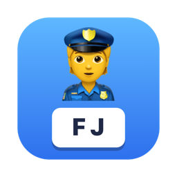
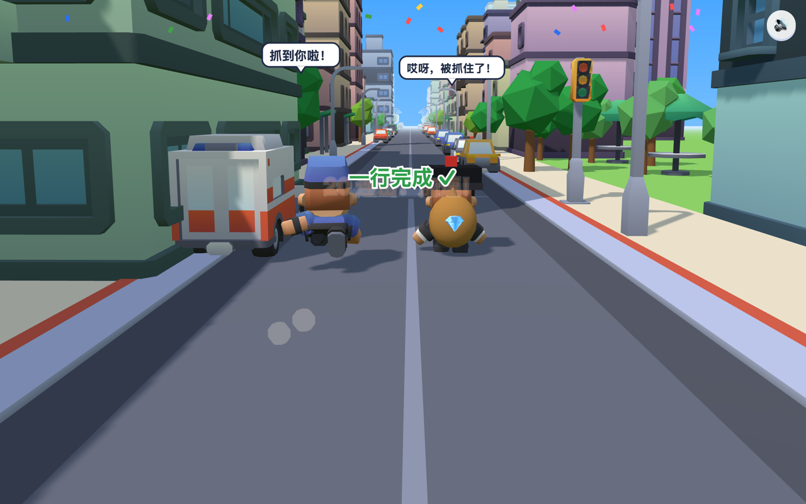

<p align="center"></p>

# 键盘小警察 · Keyboard Cop

[中文](#中文说明) · [English](#english)



## 中文说明

给孩子练习键盘指法的 macOS 小游戏。小偷抢走了宝石，孩子每敲对一个字母，小警察就往前追一步；连击越多跑得越快，追上就能抓住小偷！

### 玩法
- **3D 城市街道追逐**：three.js 渲染，有阳光阴影、楼房、红绿灯、路边停车。
- **场景与警察选择**：城市街道、林间小镇、海滨大道；经典警察、巡逻警察、机动警察，菜单展示实际 3D 预览并记住选择。
- **警察衣柜与成长**：帽子、头发、脸型、眼睛、眉毛、鼻子、嘴、上衣、裤子、鞋共 10 类、21 件物品。抓获基础 20 经验，准确率与连击最多再加 15 经验；6 个等级逐步解锁。支持真实 3D 试穿、转身、近景和跑步预览，保存后用于追捕；取消保留原搭配。进度只存本机，失败或演示不给经验。
- **指法提示**：屏幕下方的键盘按手指分颜色，下一个要按的键会闪，并提示「用左手食指按 F」。
- **8 个关卡**：基准键、加上 G H、上排键、下排键、全部字母、英文单词、拼音音节、数字键。
- **3 档速度**：🐢 慢慢跑（每分钟约 15 个字就能追上）、🐇 一般快、🚀 飞毛腿。
- **反馈**：10 连击加速、按错小偷会嘲笑并拉开距离、抓到后撒彩纸和 1–3 星评价，每关记录最好成绩。
- **声音**：按键音、脚步声、抓捕音效，加一首轻快的背景音乐（右上角 🔊 可关闭）。

操作：`←` `→` 选关卡，`1` `2` `3` 选速度，`Enter` 开始，`Esc` 暂停，`⌘F` 全屏。


### 下载安装
从本仓库 [Releases](https://github.com/fj010434-sun/type_game-for-Mac/releases) 下载 `KeyboardCop-<版本>-macos-universal.zip`，解压后把 `键盘小警察.app` 拖进「应用程序」。支持 Apple 芯片和 Intel Mac，需要 macOS 13.3 及以上，不需要安装 Xcode。

应用是本地 ad-hoc 签名，未经 Apple 公证。首次打开如被拦截，按 [Apple 官方说明](https://support.apple.com/zh-cn/102445)在「系统设置 → 隐私与安全性」中选择「仍要打开」。

### 从源码构建
需要 macOS 13.3 及以上和 Xcode 命令行工具（`xcode-select --install`）。

```bash
./build.sh            # 生成 dist/键盘小警察.app
./build.sh --install  # 同时安装到 /Applications
./build.sh --release  # 另外生成发布用 ZIP（版本号在 build.sh 顶部的 VERSION）
```

### 修改游戏
- `web/game.js`：关卡、词库、难度、界面和声音。比如在 `LESSONS` 里加一组课本单词。
- `web/world.js`：3D 街道、角色、配件、镜头和预览。
- `web/customization.js`：场景和警察选项。
- `App/main.swift`：Mac 窗口外壳（WKWebView，通过 `app://` 加载 `web/` 目录）。

想在浏览器里边改边看，可以运行 `python3 devserver.py`，然后打开 http://localhost:8765 。

### 开发验证

先运行 `python3 devserver.py`，另一个终端运行 `node tests/customization.cjs` 和 `node tests/scene-combinations.cjs`（需要 Playwright 和 Google Chrome；可通过 `PLAYWRIGHT_PATH` 指定 Playwright 安装路径）。覆盖选择保存、反复切换、警察可见性、暂停和抓获流程，以及三种场景与三种警察的全部九种组合。

新增换装验证可执行 `BASE_URL=http://localhost:8765 ./tests/run-all.sh`，串行运行素材检查、17 项成长单元测试和 6 组浏览器流程。无需网络资源，测试依赖 Playwright 和 Google Chrome。测试截图写入 `docs/wardrobe-review/`。

原生自检：构建后设置 `KC_SELFTEST` 为已存在的输出目录，启动 `dist/键盘小警察.app/Contents/MacOS/KeyboardCop`；再加 `KC_WARDROBE_TEST=1` 可检查试穿、取消、保存及实际按键抓捕。自检使用临时存储，不修改日常玩家进度。详见 [换装验证记录](docs/wardrobe-review/verification.md)。

## English

A small macOS typing game for kids. A thief has stolen a gem. Every correct key moves the little cop forward, combos make him sprint, and when he catches up the thief is caught.

- 3D chase through a city street (three.js), with colour-coded on-screen keyboard and finger hints
- 8 lessons (home row → full alphabet → English words → pinyin → numbers) and 3 thief speeds
- Combo boosts, star ratings, best-score memory, sound effects and background music

Download the universal ZIP from [Releases](https://github.com/fj010434-sun/type_game-for-Mac/releases) (Apple silicon and Intel, macOS 13.3+; ad-hoc signed, not notarized — use Open Anyway in Privacy & Security on first launch), or build with `./build.sh --install` (macOS 13.3+, Xcode command line tools). Gameplay lives in `web/game.js`, the 3D world in `web/world.js`, and the native shell in `App/main.swift`.

## 许可证 / License
游戏代码采用 [MIT 许可证](LICENSE)。第三方素材保留各自的许可，见下方。

Code is released under the [MIT License](LICENSE); third-party assets keep their own licenses below.

## 致谢 / Credits
- 3D 模型与音效：[Kenney](https://kenney.nl)（CC0 1.0，见 `web/assets/KENNEY-LICENSE.txt`）——Mini Characters、City Kit (Commercial / Roads)、Car Kit、Interface Sounds、Impact Sounds
- 3D 引擎：[three.js](https://threejs.org) r170（MIT，见 `web/vendor/three/LICENSE`）
