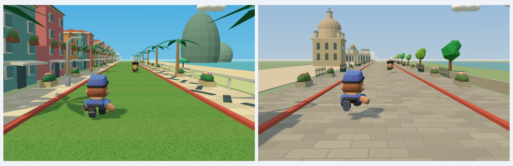

# 七城路面与沿街细节

已确认的调整：适度丰富道路两侧，保持地标视线和中央追逐通道，给七个城市采用不同路面。里约按游戏美术设计采用草地跑道，德累斯顿采用欧式错缝砖石。

| 城市 | 路面 | 沿街小物 |
|---|---|---|
| 大连 | 浅灰大石板 | 花坛、木长椅、海鸥、星海湾导览牌 |
| 东京 | 灰色小方砖 | 陶盆、灯笼、售货机 |
| 巴黎 | 暖灰鹅卵石铺地 | 咖啡桌椅、花箱、咖啡招牌 |
| 里约 | 有草叶和修剪条带的草地 | 热带花坛、遮阳伞、沙滩椅 |
| 纽约 | 深色沥青 | 消防栓、垃圾桶、地铁入口 |
| 马纳罗拉 | 暖色石砖 | 陶罐、木箱、渔具 |
| 德累斯顿 | 欧式错缝砖石 | 铁艺长椅、花坛、围栏 |

路面和人行道采用本地生成的 CanvasTexture，无新增外部图片依赖。每个城市的纹理与材质只创建一次；小物同材质零件合并后按分块复用。基本密度为每 8 米路段两侧各一个主要小物，城市特色小物间隔出现。小物不进入中央 |x| ≤ 4.25 米范围，地标前优先使用低矮花坛和长椅。

截图由实际 World 实例和游戏镜头生成，隐藏了菜单和 HUD，方便检查路面与沿街细节。不是独立概念图。

复现：启动 `python3 devserver.py` 后，运行 `BASE_URL=http://127.0.0.1:8765 node tests/city-streets.cjs`。

新增检查覆盖七种不同路面纹理、草地色彩、砖石纹理细节、小物存在与追逐通道净空；其余场景切换、经典场景回退、成长和换装仍由完整回归覆盖。

## 验证结果（2026-10-15）

`BASE_URL=http://127.0.0.1:8765 ./tests/run-all.sh` 本次完整执行退出码为 0：两组素材检查、23 项单元测试及 14 个浏览器检查脚本均完成。覆盖原有成长与换装、经典场景、7 城 × 3 警察、配乐、地标回收、选择与静音保存，以及新增路面和小物净空。

`./build.sh` 退出码为 0，通用 macOS 应用已更新；`codesign --verify --deep --strict` 通过，打包的 web 目录与当前源码一致。本次路面更新的视觉检查在浏览器完成，没有把它描述为重新完成了原生全流程或人工配乐试听。

代码复核未发现重要问题。模型与纹理缓存有界，经典场景的无纹理人行道材质会恢复，新增模型仍参与原有分块回收。
